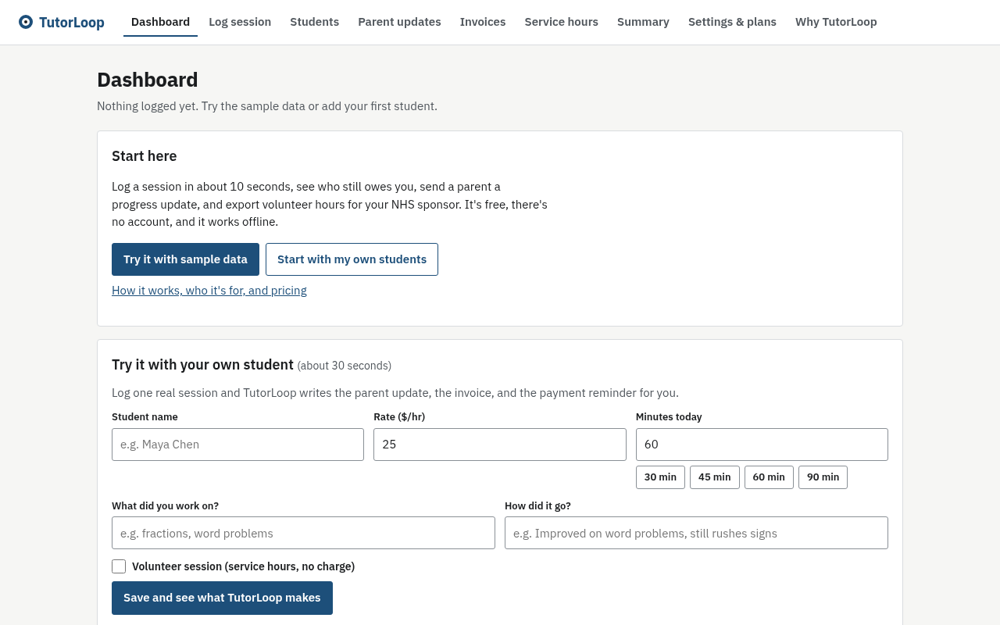

# TutorLoop

**Live demo:** https://aariv.me/Tutorloop/ · **Why TutorLoop / pricing:** https://aariv.me/Tutorloop/#about (GitHub Pages on a custom domain; the github.io address redirects there). Click **"Try it with sample data"** to explore. The sample students are fictional.

**The back office for student tutors.** Log a session in about 10 seconds, see who still owes you, send parents a progress update or a payment reminder in one click, print an invoice, and export volunteer hours for your NHS sponsor. It's free and private, and it works offline after your first visit.



*Screenshot of the live site (Oct 2026), taken with headless Chromium.*

Built by Aariv Patel for the [Next Founders Hackathon](https://next-founders.devpost.com/) (October 2026).

---

## The problem

Lots of high school and college students tutor younger kids in math, reading, or test prep. Some do it for pay, and some as volunteer tutoring for NHS service hours. Their "back office" is spread across the Notes app, Venmo, and memory:

- Sessions aren't tracked, so tutors **forget who owes them**, and chasing payment is awkward.
- Parents want to know whether tutoring is working, but writing **progress updates** by hand takes time, so most tutors never send them.
- At the end of the semester, volunteer tutoring hours have to be **re-typed into a log** for a sponsor.

Tutoring-company software (scheduling and billing suites) is built for businesses with staff. It's far more than a 16-year-old with four students needs or can pay for.

## Features

| Feature | Details |
|---|---|
| **Dashboard** | Earned and collected this month, all-time unpaid balance, service hours (with goal progress), a 6-month earnings chart, a "Who owes you" list with Invoice / Remind / Mark paid buttons, and **Quick log** buttons that start from your last session with each student |
| **30-second first run** | On an empty app, one quick-start form (student, rate, minutes, topics, how it went) creates the student and the first session, then the dashboard shows the drafted parent update, the invoice amount, and next steps |
| **10-second session log** | Student, date, minutes (quick 30/45/60/90 chips), optional rate override, topics, notes, paid or volunteer, with a live amount preview |
| **Smart parent updates** | Turns session topics and notes into a parent-ready progress email: topics ranked, a recency-weighted trend, the latest highlight, and the next focus. Presets for the last 30 days, this month, the last 90 days, or all sessions. **You can edit the text before you copy it or open it in your email app.** |
| **Payment reminders** | One click opens a polite, itemised reminder (dates, minutes, amounts, total, and "You can pay with Venmo @handle") addressed to the parent. The payment app is a setting, guessed from the handle if blank |
| **"Sent with TutorLoop" footer (optional)** | Off by default. Switch it on in Settings to end parent updates, reminders, and invoices with one plain link to TutorLoop. No tracking or referral code |
| **Invoices and part payments** | Unpaid sessions roll into a clean invoice (Print / Save as PDF) with a stable invoice number. Got only part of the money? Record the amount: it settles the oldest sessions first and keeps the remainder as a part payment, so the balance, the reminder email, the invoice and the monthly statement all show what is still owed (cent-exact, undoable, never more than the balance) |
| **Service hours** | Volunteer sessions count as $0, track progress toward an optional hour goal, export to CSV, and print as a sponsor log with a signature line |
| **Monthly summary** | Pick a month and one student (a family statement: sessions, topics, paid/unpaid, balance due, how to pay) or all students (a recap for you or your NHS sponsor, with service hours and a signature line when printed). Print / Save PDF, copy as text, or open in email |
| **Your data, your device** | Everything stays in `localStorage`. JSON backup and restore, CSV export, undo for every change (toast button or Ctrl/Cmd+Z), archive/restore students, and permanent delete when a family asks |
| **Freemium plans** | Free (3 active students), Pro, and Club, with the free limit enforced in the app. Settings shows your usage (e.g. 2 of 3 students) and what Pro costs in minutes of your own tutoring at your average rate. **Checkout is simulated, and no payment is taken.** |
| **Works offline / installable** | A service worker caches the app shell, and the web manifest lets you add it to your home screen |

## Tech stack and architecture

- **Vanilla HTML, CSS, and JavaScript.** No framework, no build step, no paid APIs, no server. Deploys as static files on GitHub Pages.
- `js/core.js` holds **pure business logic** with no DOM access, so it runs in Node and is unit-tested: money math rounded to cents, stats, balances, invoices, CSV export with formula-injection protection, import validation and migration, payment reminders, and the progress-report engine.
- `js/app.js` is a small **hash router** (`#dashboard`, `#log`, `#students`, `#reports`, `#invoices`, `#hours`, `#summary`, `#settings`, `#about`) with view functions, delegated event handlers, and snapshot-based undo.
- `sw.js` + `manifest.webmanifest`: offline app shell (network first, cache fallback), installable PWA.
- **Chart**: drawn with the Canvas 2D API, with no chart library and a text alternative for screen readers.
- **Persistence**: one versioned JSON document in `localStorage` (`tutorloop.v1`). Every load goes through `importState()`, which normalises types and drops bad rows.

```
index.html ─ styles.css ─ manifest.webmanifest ─ sw.js (offline cache)
   │
   ├── js/core.js   pure logic: stats, invoices, reminders, reports, CSV, validation   ← tests/core.test.js (unit)
   └── js/app.js    router, views, events, undo, localStorage                          ← tests/smoke.dom.js (jsdom)
                                                                                         ← tests/e2e.py (real Chromium)
```

### Why the "AI" runs on the device

Parent updates come from a deterministic, explainable text engine that runs in the browser:

1. Topics are counted and ranked (ties go to the most recent).
2. Each note is scored with whole-word patterns for progress ("improved", "confident", "mastered") and struggle ("confused", "needs more practice"). Phrases are only counted once, and negation is handled both ways: "not confident" is a struggle, and "wasn't confused" is progress.
3. Each session votes +1, −1, or 0, **weighted by recency**, so the trend reflects where the student is now. A struggle followed by a win is reported as "turning around" instead of re-quoting the old problem.
4. The latest win becomes the highlight. If the latest signal is a struggle, it becomes the next focus. Otherwise the summary says what's next.

The result is **$0 per report, no student data sent to a third party, and it works offline**. The tutor reviews and edits every message before sending. An optional LLM rewrite for Pro is on the roadmap, not built.

## Quality: what is tested

| Suite | Command | What it covers |
|---|---|---|
| Unit (60 tests, no dependencies) | `npm test` | Money and rounding, validation (including impossible dates), plan limits, stats, balances, monthly series, goal progress, presets, sentiment and negation, report wording, reminders, payment-app wording, the opt-in footer, monthly summaries and statements, Pro value math, invoices, CSV escaping and **formula injection**, import normalisation, and a 5,000-session performance check |
| DOM smoke (45 checks, jsdom) | `npm i && npm run test:dom` | Every route renders, quick start and first-run card, toast close/Escape/removal, monthly summary, plan usage, forms, plan limit, **XSS escaping**, persistence, undo, bad URLs, pitch-page honesty and fee math |
| End-to-end (152 checks, real headless Chromium, app served from a `/Tutorloop/` sub-path like production) | `pip install playwright && python -m playwright install chromium && python tests/e2e.py` | Real clicks with native form behaviour, the first-run quick start, toast auto-dismiss (and hover pause, close, Escape), the monthly summary, decimal rates, XSS, undo (button and Ctrl+Z), CSV download, plan limit, archive/restore/delete, report presets and editing, backup round trip, corrupt-storage recovery, keyboard focus and skip link, a **keyboard-only Record a payment pass at 390px and 1280px** (Tab order, errors announced and linked to the field, no traps, Escape/Undo on the toast return focus, arrow keys on the invoice and Summary month/student pickers keep focus on the picker), **offline reload through the service worker**, **service worker scope, manifest paths and cache isolation on a shared origin**, payment-app setting and footer opt-in/out, sourced competitor prices on the pitch page, no console errors, **axe-core WCAG 2.1 AA: 0 violations on all 9 pages plus the empty and first-run dashboards**, **no serious or critical axe issues on any page at 390px**, **no horizontal overflow at 1280px and 390px**, and print stylesheets |

All three suites were re-run on Oct 11, 2026 (~3:30 PM ET): **60/60 unit, 45/45 DOM, 152/152 end-to-end passing**.

`docs/REVIEW_LOG.md` records the review loop used to harden the app: the problems found in each iteration and how each was fixed.

## Data sources

- **No external data APIs.** Everything the app shows comes from what the tutor types in, stored in their own browser.
- **Sample data** ("Try it with sample data") is fictional students and sessions built into the app.
- **Competitor prices** on the pitch page (`#about`) are TutorBird's and Teachworks' list prices, each linked to the vendor's own pricing page ([tutorbird.com/pricing](https://www.tutorbird.com/pricing/), [teachworks.com/pricing](https://teachworks.com/pricing)); the end-to-end suite checks the figures and links are there.

## Security and privacy

- All user text is HTML-escaped before rendering. The tests try `` payloads.
- A strict **Content-Security-Policy** (`default-src 'self'`, no inline scripts or styles), plus `no-referrer`.
- CSV exports neutralise spreadsheet formulas (`=`, `+`, `-`, `@`) so a malicious topic can't run when a sponsor opens the file.
- There's no backend, so student data stays on the tutor's device. Unreadable saved data is set aside, never silently overwritten. Families' data can be permanently deleted.

## Scalability

- **Today:** static files on a CDN (GitHub Pages), so serving 10 or 100,000 tutors costs the same. Each tutor's data lives on their own device, so there's no server bottleneck. A unit test runs stats, balances, the 6-month chart series, and a report over 5,000 sessions and 50 students, and fails if they take longer than 1.5 seconds. In Node on the dev sandbox they took about 30 ms. A browser check loads 50 students and 5,000 sessions (about 0.9 MB, well inside the localStorage limit) and the dashboard re-renders in about 0.2 s. Reminders for a long backlog roll the oldest sessions into one line, and email links are capped, so a tutor with 60 unpaid sessions still gets a message their mail app can open.
- **Next (Pro):** cloud sync through hosted Postgres (for example Supabase) with row-level security per tutor. `core.js` doesn't change, because it already works on one JSON state object that maps onto `tutors`, `students`, and `sessions` tables.
- **Club:** a `club_id` and read-only sponsor roles so a chapter sponsor can see verified hours across their tutors.

## Business model

| Plan | Price | For |
|---|---|---|
| Free | $0 | Up to 3 active students: the full core loop |
| Pro | $4/month or $36/year | Unlimited students now. Cloud sync and scheduled reminders are on the roadmap |
| Club | $99 per school year | NHS chapters and peer-tutoring clubs (up to 50 tutors). Sponsor dashboard and verified hour reports are on the roadmap |

The cost to serve a free user is close to $0 (static hosting, on-device processing). See `devpost.md` for the pitch, go-to-market plan, and video script.

## Run locally

```bash
python3 -m http.server 8080      # then open http://localhost:8080
npm test                         # unit tests (no install needed)
npm i && npm run test:dom        # jsdom smoke test
python3 tests/e2e.py             # e2e (needs: pip install playwright && python -m playwright install chromium; or CHROMIUM_PATH=/usr/bin/chromium to use a system Chromium)
SHOTS=out python3 tests/e2e.py   # e2e + screenshots of every page (desktop, mobile, print)
```

## Deploy (GitHub Pages)

Repo **Settings → Pages → Build and deployment → Source: Deploy from a branch → Branch: `main` / `(root)` → Save.** The site goes live in about a minute. This repo is served at `https://aariv.me/Tutorloop/` because the account's user site uses the custom domain `aariv.me`. Note that GitHub Pages paths are case-sensitive: `/Tutorloop/` works, `/tutorloop/` is a 404.

## Known limits (honest)

- Data lives in one browser. Use **Download backup** to move it to another device (there's no sync yet).
- Payment is tracked, not processed. Reminders and updates open in your own email app.
- Plan upgrades are simulated. "Cloud sync", "scheduled reminders", and the "Club sponsor dashboard" are roadmap items.
- The update engine is rule-based and English-only. It's good at summarising notes, but it doesn't understand them like a person would, which is why every message is editable.

## AI assistance

This project was built with help from an AI assistant (Hark), which drafted code, tests and copy under Aariv Patel's direction. The app itself calls no AI service: parent updates come from the on-device, rule-based engine described above.

## Roadmap

1. Cloud sync and login (Pro)
2. Scheduled payment reminders by email or text
3. Recurring weekly sessions and a calendar view
4. Club sponsor dashboard with verified service hours
5. Optional LLM polish for parent updates

## License

MIT © 2026 Aariv Patel
